# Revisal

**[⬇️ تنزيل التطبيق (Revisal-unsigned.ipa)](https://github.com/ibnkabed/revisal/releases/latest/download/Revisal-unsigned.ipa)** · [دليل الاستخدام](دليل-الاستخدام.md) · [كل الإصدارات](https://github.com/ibnkabed/revisal/releases)

تطبيق آيفون مجاني ومفتوح المصدر يساعد الطالب على مراجعة ما ذاكره، في المواد الدراسية وفي اختبارات قياس (القدرات والتحصيلي)، بأسئلة «اختر الإجابة الصحيحة» من أربعة خيارات. وكل الحل على الجوال نفسه: لا طباعة ولا أوراق.

- **المنهج:** يضيف الطالب كتاب أي مادة أو ملخصًا لها بصيغة PDF، ويسمّي وحداته بصفحاتها، ويختار وحدة وعدد الأسئلة من 1 إلى 10. يكتب الذكاء الاصطناعي الأسئلة بمفتاح الطالب المجاني، موزعة على أقسام الوحدة ومهاراتها، وزر «حدّث» يأتي بأسئلة جديدة لم تُسأل من قبل.
- **التحصيلي** (الرياضيات والفيزياء والكيمياء والأحياء) **والقدرات** (اللفظي والكمي): بنك أسئلة داخل التطبيق، يعمل بلا إنترنت: 2004 أسئلة للتحصيلي (قرابة 500 لكل مادة)، و4007 أسئلة للقدرات (2002 لفظي و2005 كمي)، بمهارات متنوعة. لا يتكرر سؤال حتى يمر الطالب على البنك كله.
- **«اشرح لي»:** تحت كل سؤال، يكتب الذكاء الاصطناعي سبب الإجابة الصحيحة عند الطلب فقط، بمفتاح الطالب، ويُحفظ الشرح في الجوال.
- **النتيجة:** الدرجة، والدرجة حسب المهارة، وكل سؤال بإجابة الطالب والإجابة الصحيحة، وزر «أعد أخطائي».
- **الخصوصية:** كل البيانات في الجوال وحده، والمفاتيح في Keychain، والجوال يتصل بمزوّد الذكاء الاصطناعي مباشرة.

## مقطع توضيحي

[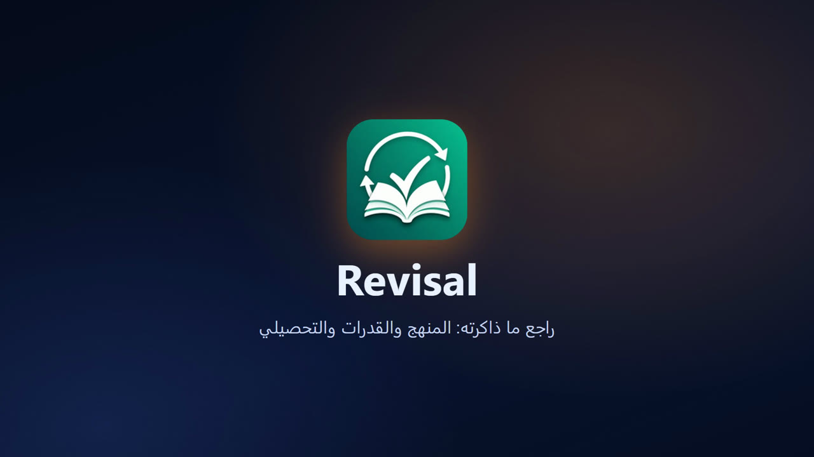](https://youtu.be/OfxgbbrDcUA)

**[شاهده على YouTube](https://youtu.be/OfxgbbrDcUA)** · [نزّل المقطع](docs/video/Revisal-demo-ar.mp4)

## صور من التطبيق

| بنك القدرات | سؤال مقارنة | بعد الإجابة و«اشرح لي» |
| --- | --- | --- |
| 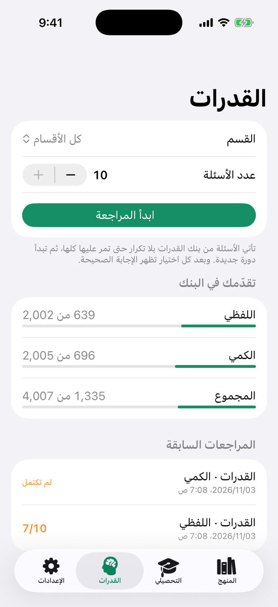 | 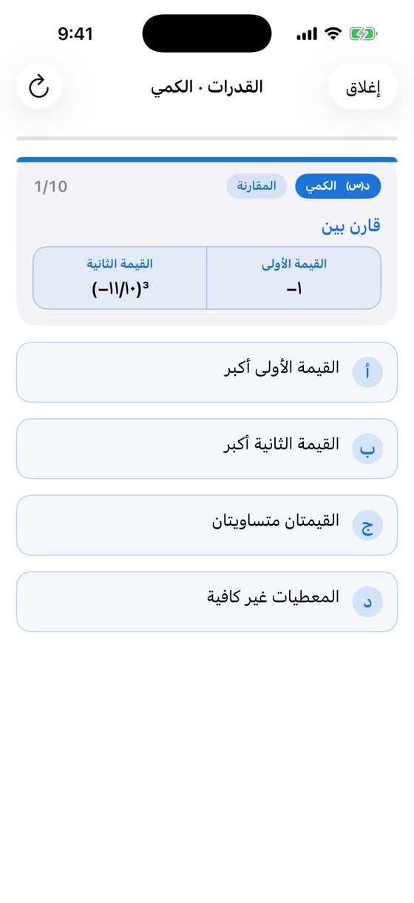 | 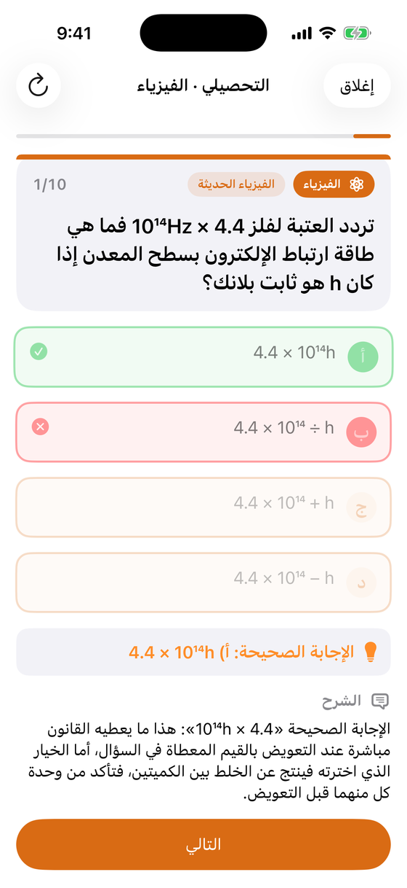 |

| النتيجة حسب المهارة | المنهج والملخصات | مزودو الذكاء الاصطناعي |
| --- | --- | --- |
| 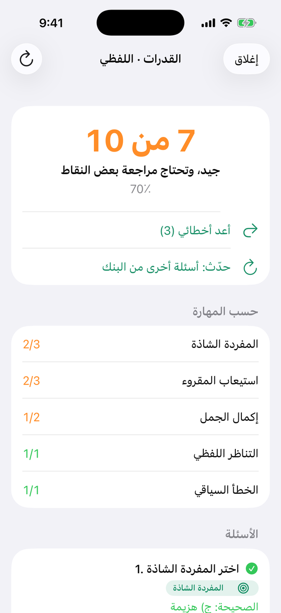 | 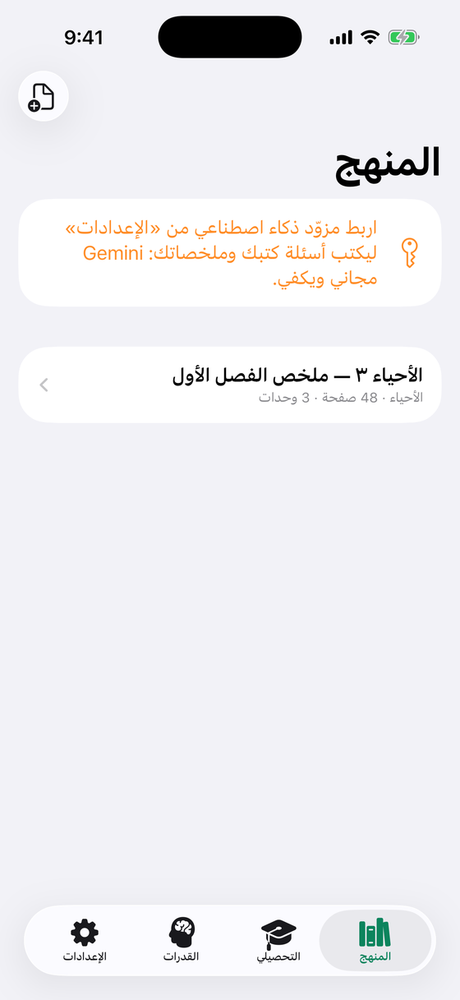 | 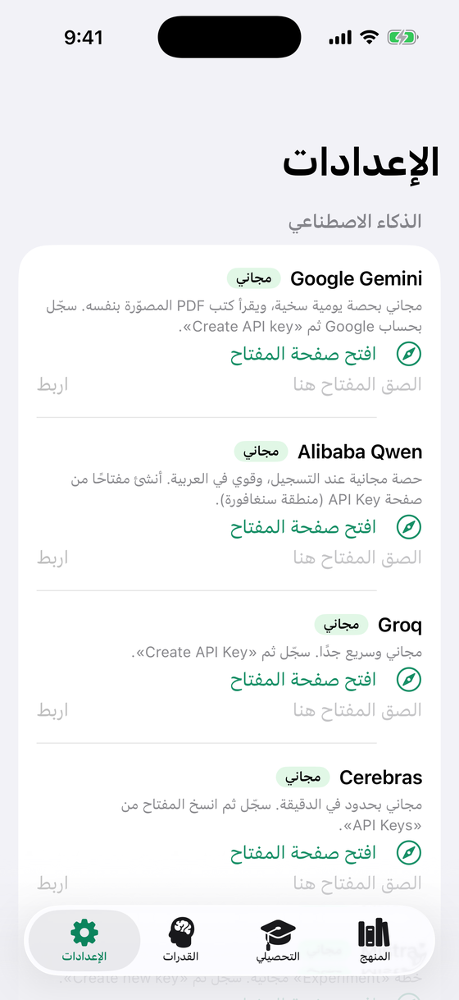 |

## الوضع الداكن

يتبع التطبيق مظهر الآيفون تلقائيًا، فإذا كان الجوال على الوضع الداكن ظهر به.

| سؤال | بعد الإجابة | البنك | النتيجة |
| --- | --- | --- | --- |
| 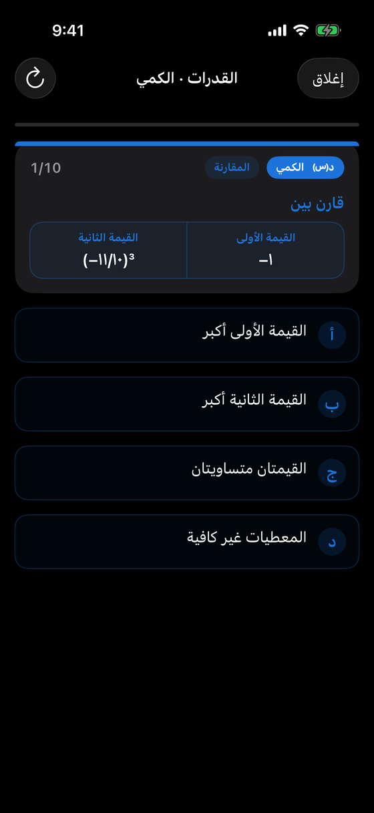 | 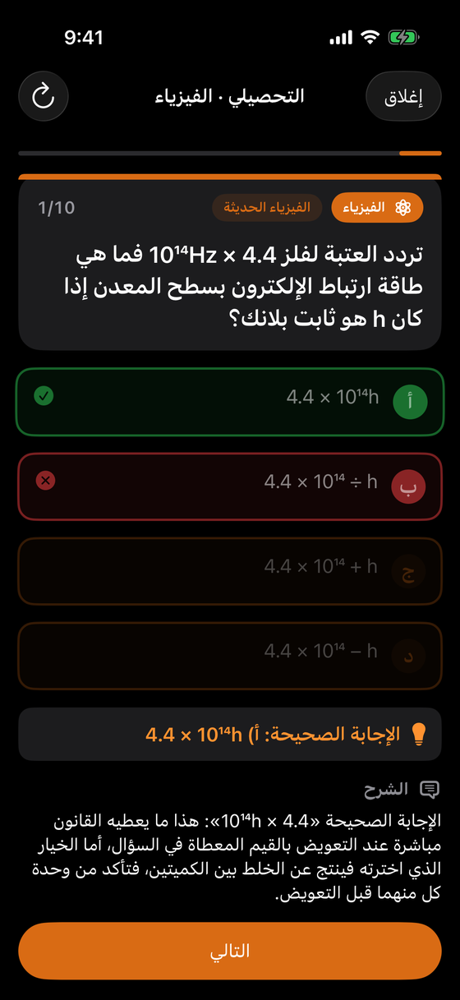 | 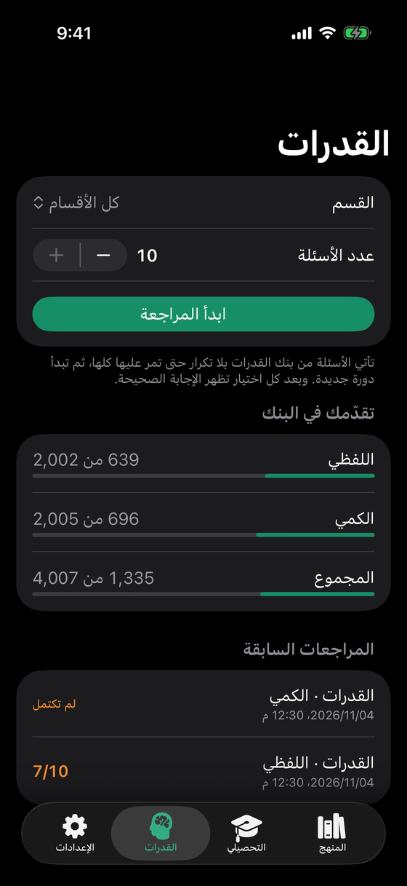 | 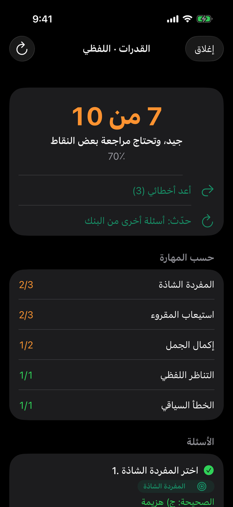 |

## التثبيت

نزّل أحدث `Revisal-unsigned.ipa` من صفحة [الإصدارات](https://github.com/ibnkabed/revisal/releases)، وثبّته بـ [Sideloadly](https://sideloadly.io/) وحساب Apple مجاني. والخطوات كاملة في [دليل الاستخدام](دليل-الاستخدام.md).

## مزودو الذكاء الاصطناعي

للمنهج و«اشرح لي» فقط. يربط الطالب مفتاحًا مجانيًا واحدًا على الأقل من «الإعدادات»: Gemini (ويقرأ وحده صفحات PDF المصوّرة وأشكال الأسئلة)، أو Qwen وGroq وCerebras وMistral وOpenRouter، أو DeepSeek الرخيص. وإن رُبط مزوّدان راجع الثاني إجابات الأول.

## البناء

يُبنى التطبيق بلا Mac على GitHub Actions (`.github/workflows/build-ipa.yml`): يفحص قواعد المراجعة والبنكين، ثم يخرج `Revisal-unsigned.ipa`، وكل وسم `v*` يرفقه بإصدار.

## المساهمة

الملاحظات والاقتراحات وتصحيح الأسئلة مرحب بها عبر [Issues](https://github.com/ibnkabed/revisal/issues)، والتفاصيل في [دليل المساهمة](CONTRIBUTING.md).

## الترخيص

الترخيص MIT: يسمح باستعمال التطبيق ونسخه وتعديله ونشره مجانًا، بشرط إبقاء سطر الحقوق في كل نسخة.

Copyright (c) 2026 IbnKabed
